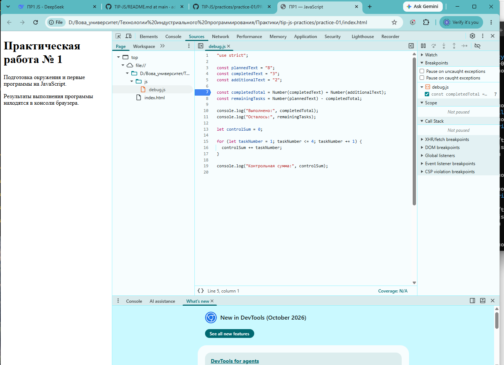

# Практическая работа № 1

## Автор и вариант

- Имя: Петренко Владимир
- Группа: ЭФБО-17-25
- Вариант: 3 (totalTasks = 9, completedTasks = 9, dailyLimit = 3)

## Окружение

- ОС: Windows
- Node.js: v24.21.0
- npm: 11.19.0
- Git: 2.56.0.windows.2
- Браузер: Chrome

## Запуск

Из корня репозитория:

    node practice-01/js/hello.js
    node practice-01/js/types.js
    node practice-01/js/progress.js
    node practice-01/js/plan.js
    node practice-01/js/debug.js

В браузере: открыть practice-01/index.html, заменить src в script на нужный файл, обновить страницу, смотреть Console.

## Задание 1

- В Node.js: Тип document: undefined
- В браузере: Тип document: object
- Причина: document — часть DOM API браузера, в Node.js его нет.

## Задание 2

| № | Выражение | Ожидание | Факт | Тип | Объяснение |
|---|-----------|----------|------|-----|------------|
| 1 | "8" + 2 | "82" | "82" | string | + со строкой даёт конкатенацию |
| 2 | "8" - 2 | 6 | 6 | number | - всегда приводит к числу |
| 3 | Number("8") + 2 | 10 | 10 | number | явное преобразование строки в число |
| 4 | "12" > "3" | false | false | boolean | строки сравниваются лексикографически |
| 5 | 12 === "12" | false | false | boolean | строгое равенство без приведения типов |
| 6 | Number("") | 0 | 0 | number | пустая строка преобразуется в 0 |
| 7 | Number("text") | NaN | NaN | number | не число даёт NaN, тип остаётся number |
| 8 | Boolean("false") | true | true | boolean | непустая строка даёт true |
| 9 | typeof null | "object" | "object" | string | историческая особенность JS |
| 10 | typeof NaN | "number" | "number" | string | NaN имеет числовой тип |

## Задание 3

Вариант 3: totalTasks = 9, completedTasks = 9.

Фактический вывод:

    Всего задач: 9
    Выполнено: 9
    Осталось: 0
    Прогресс: 100.0%
    Статус: Завершено

Проверки:

| Проверка | Входные данные | Ожидание | Факт | Итог |
|----------|----------------|----------|------|------|
| Обычный | 9 / 9 | 100.0%, Завершено | 100.0%, Завершено | Пройдено |
| Нет задач | 0 / 0 | Задач пока нет | Задач пока нет | Пройдено |
| Ничего не выполнено | 5 / 0 | 0.0%, Не начато | 0.0%, Не начато | Пройдено |
| Всё выполнено | 5 / 5 | 100.0%, Завершено | 100.0%, Завершено | Пройдено |
| Больше чем есть | 5 / 6 | Ошибка | Ошибка completedTasks | Пройдено |
| Отрицательное | -1 / 0 | Ошибка | Ошибка totalTasks | Пройдено |
| Дробное | 5 / 2.5 | Ошибка | Ошибка целого числа | Пройдено |
| Строка | "5" / 2 | Ошибка | Ошибка целого числа | Пройдено |
| Слишком много | 1001 / 0 | Ошибка | Ошибка totalTasks | Пройдено |
| NaN | NaN / 0 | Ошибка | Ошибка целого числа | Пройдено |

## Задание 4

Вариант 3: totalTasks = 9, completedTasks = 9, dailyLimit = 3.

Фактический вывод:

    Все задачи уже выполнены
    Потребуется дней: 0

Дополнительный прогон на общем примере 12 / 5 / 3:

    Осталось задач: 7
    День 1: выполнено 3, осталось 4
    День 2: выполнено 3, осталось 1
    День 3: выполнено 1, осталось 0
    Потребуется дней: 3

Проверки:

| Проверка | Входные данные | Ожидание | Факт | Итог |
|----------|----------------|----------|------|------|
| Вариант 3 | 9 / 9 / 3 | 0 дней | 0 дней | Пройдено |
| Общий пример | 12 / 5 / 3 | 3 дня, в последний 1 | совпало | Пройдено |

## Отладка

Исходный (сломанный) вывод:

    Выполнено: 32
    Осталось: -24
    Контрольная сумма: 6

Причины:

1. completedTotal вычислялся как "3" + "2" = "32" — конкатенация строк вместо сложения. Исправление: Number(completedText) + Number(additionalText).
2. Цикл шёл до taskNumber < 4, поэтому сумма была 1+2+3 = 6. Исправление: taskNumber <= 4 даёт 1+2+3+4 = 10.

Исправленный вывод:

    Выполнено: 5
    Осталось: 3
    Контрольная сумма: 10

Скриншот отладки: 

## Вывод

В ходе работы подготовлено окружение Node.js 24 LTS, Git и браузер Chrome. Освоены базовые типы данных, преобразования, условия и циклы. Наиболее показательной была ошибка конкатенации строк вместо сложения — она не вызывает исключения и не видна без отладки, но даёт неверный результат.
